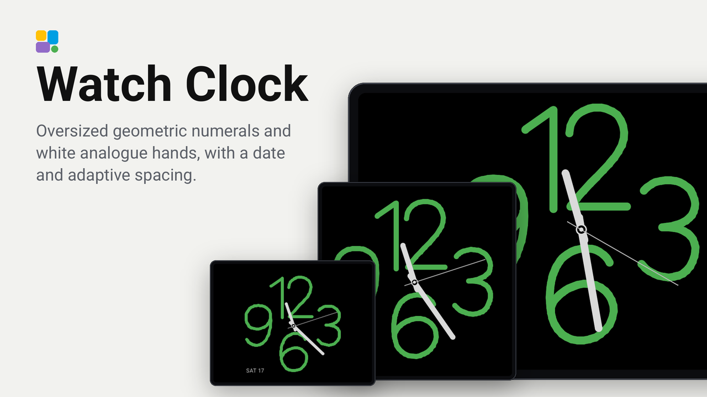

# Watch Clock for Tessera

A native screensaver face for Tessera, ported from [Watch Clock for Kiosk Satellite](https://github.com/dark-matter-design/kiosk-satellite-watch-clock-screensaver). The original oversized geometric 12, 3, 6 and 9 are drawn as vector polylines, with rounded white hour and minute hands, a fine seconds hand and an optional date. No browser, external font, image download or Android component is needed.



Full firmware previews: [4-inch square](docs/previews/guition-4-inch.png), [7-inch](docs/previews/guition-7-inch.png), [10.1-inch adaptive](docs/previews/guition-10-inch-adaptive.png).

**Requires Tessera plugin API 0.14 or newer.** Tessera rejects installation on older firmware. Check the API supported by your installed Tessera version; use the Tessera dev channel if its stable release does not yet include screensaver plugins.

## Set up

1. Open **Plugins** in Tessera and choose **Add with a link**.
2. Paste `https://github.com/dark-matter-design/tessera-watch-clock-screensaver`.
3. Add Watch Clock to your screen and build its firmware.
4. Open that screen's **Settings → Screensaver**, open the **Clock** step and choose **Watch Clock** under **Face**.
5. Enable **Auto standby**, use a standby brightness above zero and put Clock where you want it in the screensaver order. Any earlier active step takes priority.
6. Adjust the face options in the Clock drawer. Touching the face wakes the screen normally.

For folder installation, copy the manifest, `plugin.yaml`, `components/`, `translations/`, README and changelog into `/config/tessera-plugins/watch_clock/` beside Home Assistant's `esphome` folder, then add it from Tessera.

## Options

| Option | Choices / default |
| --- | --- |
| Numeral colour | Green (default), White, Blue, Purple, Amber; Tessera theme colours |
| Layout | Original proportions (default), Adaptive spacing |
| Scale | 50–100%, default 100% |
| Alignment | Centre (default), Left, Right, Top, Bottom |
| Seconds hand | On by default; one tick per second |
| Show date | On by default |
| Date position | Bottom left (default), Bottom right, Top left, Top right |
| Date format | Short weekday and day (default), Day and short month, Numeric YYYY-MM-DD |
| Time zone | Screen time zone (default, follows Tessera including DST), UTC |

Adaptive spacing extends the composition on the longer axis, capped at 1.65 times its square dimension. Hands and numerals keep the source proportions. A small inset preserves Tessera's burn-in movement at every alignment. The date uses Tessera's body font; weekday and month abbreviations come from the plugin's translations (English included). Until the screen's clock is synchronised, the numerals remain visible and the hands and date are hidden.

## Differences from Kiosk Satellite

Tessera's screensaver API updates once per second, so the seconds hand ticks instead of sweeping. Screensavers use a black background and theme colours: the source's full green background, light palettes and custom hex colour pickers are unavailable. This port keeps green numerals as the default accent. Time zones are Screen or UTC; choose an IANA time zone in Tessera's screen settings. Numeric dates use ISO order. This clock does not display the Clock step's temperature or entity row.

Tessera owns activation, brightness, night hours, step selection, burn-in movement, wake, alerts and firmware updates. The plugin adds a face to the Clock step, with no extra permissions or network access. Boards that do not support Tessera standby cannot show it.

## Development and validation

The project was generated with Tessera's official plugin template. Clone the [plugin tools](https://github.com/MaxGramser/tessera-plugins) beside this repository, then run:

```sh
pip install pyyaml
python ../tessera-plugins/tools/check.py .
python tools/generate_numerals.py
python tools/test.py
python ../tessera-plugins/tools/preview.py . --strict
python ../tessera-plugins/tools/store_image.py . --from .preview
```

The official preview bench needs Linux/macOS or WSL with a C++ compiler and SDL2. GitHub Actions runs the manifest checker, geometry tests and real firmware preview on four screen sizes. Its downloadable `watch-clock-preview` artifact contains rendered screens and findings. See [validation notes](docs/VALIDATION.md) for test coverage and hardware limitations.

The additional Guition checks cover the 7-inch JC1060P470 and V2 (1024 × 600), alongside the square 4-inch ESP32-S3-4848S040 (480 × 480) and 10.1-inch JC8012P4A1 (1280 × 800). Both 7-inch boards support standby in Tessera's catalog; their hardware support is marked experimental upstream.

The plugin is installed from source; no Kiosk Satellite ZIP, DEX or APK is used. Without a GitHub release, Tessera follows the default branch as a test installation. Releases are intentionally deferred until a real screen has been tested.

## Credits

Original geometric numeral outlines and watch proportions: dark-matter-design's Kiosk Satellite Watch Clock, Apache-2.0. Tessera plugin scaffolding: MaxGramser's Tessera plugin template, MIT. See [THIRD_PARTY_NOTICES.md](THIRD_PARTY_NOTICES.md). Independent community plugin; no proprietary Apple font or artwork is included.
